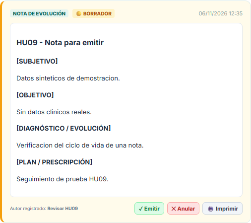
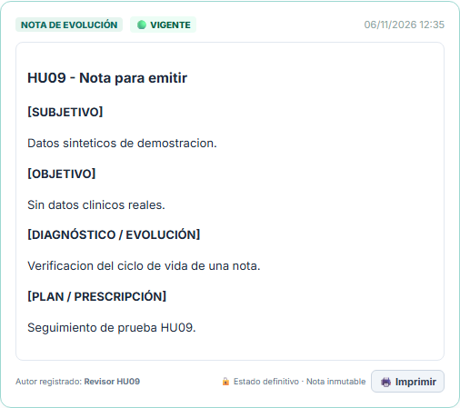
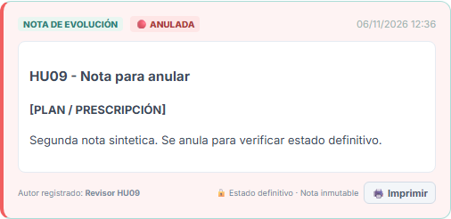

# HU-09: ciclo de vida de notas médicas

Verificación local del 2026-11-06. Base git `91fb767` más cambios sin commit. No demuestra el estado de AWS.

## Recorrido real en navegador

Playwright controló Chromium contra Angular en `http://localhost:4200` y la API Spring Boot local. Las notas se crearon con el formulario SOAP, se guardaron, y se emitieron/anularon pulsando los botones reales. No se simularon respuestas de API ni se alteraron las capturas. El paciente y los textos clínicos son sintéticos.

1. [Formulario de creación](01-formulario-borrador.png): solo permite guardar como BORRADOR.
2. [Borrador guardado](02-borrador-con-acciones.png): ofrece Emitir y Anular.
3. [Nota emitida](03-vigente-inmutable.png): VIGENTE y aviso de estado definitivo, sin botones de transición.
4. [Segundo borrador](04-segundo-borrador.png): una nota independiente permite probar la otra rama.
5. [Nota anulada](05-anulada-inmutable.png): ANULADA y aviso de estado definitivo, sin botones de transición.
6. [Recarga de página](06-persistencia-al-recargar.png): ambos estados permanecen; la API devolvió VOIDED y APPROVED.

### Borrador

### Vigente

### Anulada

## Reglas y resultados

| Criterio | Evidencia |
|---|---|
| Solo DRAFT -> APPROVED o VOIDED | Ambas ramas ejecutadas por interfaz y persistidas |
| Estados terminales inmutables | PATCH posterior devuelve 409 INVALID_TRANSITION; PostgreSQL también bloquea cambios |
| Botones solo en DRAFT | El navegador contó cero botones Emitir/Anular después de finalizar ambas notas |
| Badges dinámicos | Amarillo BORRADOR, verde VIGENTE y rojo ANULADA, visibles en las capturas |
| No saltar el borrador | POST con status APPROVED devuelve 400 BAD_REQUEST |
| Concurrencia | Dos PATCH simultáneos sobre el mismo borrador: uno exitoso, otro 409; bloqueo pesimista de fila |
| Autor real | Se eliminó el nombre fijo del médico; la vista y la impresión muestran el usuario actual cuando es autor, o el identificador del autor histórico |

[Resultados HTTP reales](api-results.json). Las pruebas negativas y de concurrencia usaron notas sintéticas adicionales; las capturas finales usan otro paciente sintético para mostrar las dos ramas con claridad.

## Verificaciones técnicas

- MedicalNoteServiceTest: 23 casos, cero errores y fallos. Incluye todos los estados iniciales y destinos inválidos y ambos estados terminales.
- Build Angular de producción: correcto, con advertencias existentes de compilador/optimización.
- Backend empaquetado y ejecutado localmente; login, alta de paciente, listado y creación/transición de notas por HTTP comprobados.
- [Prueba SQL](../../../database/tests/hu09_medical_note_lifecycle.sql): seis mutaciones inválidas bloqueadas y transición válida; termina en ROLLBACK.
- Validador wiki: 31 páginas y 133 contratos comprobados.

La compilación de todas las pruebas está bloqueada por errores preexistentes en AuthServiceIsolatedRefreshTest (sobrecarga ambigua de generateToken y uso de accesores de record sobre AuthResponse). Para comprobar HU-09 se compiló su prueba explícitamente con javac y el classpath Maven, y se ejecutó con Surefire. No se presenta el conjunto completo como aprobado.

## Entorno y límites

La migración 088 se aplicó en el PostgreSQL local y en la base de demostración. No se aplicó a AWS desde esta tarea. Se conservó un respaldo previo fuera del repositorio, en la carpeta local `.nexodocs/hu09` del usuario.

El alta normal del tenant de demostración encontró TENANT_AUDIT_CHAIN_INVALID en el worker de aprovisionamiento. Para aislar la prueba de HU-09, se preparó una base local desechable `nexodocs_t_00000000000000000000000000000009` y se dirigió exclusivamente la organización sintética de esta tarea hacia ella. La base se obtuvo de un snapshot local: las capturas usan únicamente pacientes sintéticos nuevos. No se modificaron organizaciones existentes. Este ensayo no certifica el aprovisionamiento automático.

El login además encontró un SELECT set_config ejecutado como jdbc.update en AuthSessionService. Se corrigió a jdbc.queryForMap y se comprobó el login por HTTP. Se conservaron los demás cambios locales de autenticación.

Los archivos y el jar se actualizaron en los contenedores locales existentes, conservando su configuración. Para futuros despliegues debe reconstruirse la imagen con estas fuentes y ejecutar la migración en cada base correspondiente. No se hizo commit ni push.
