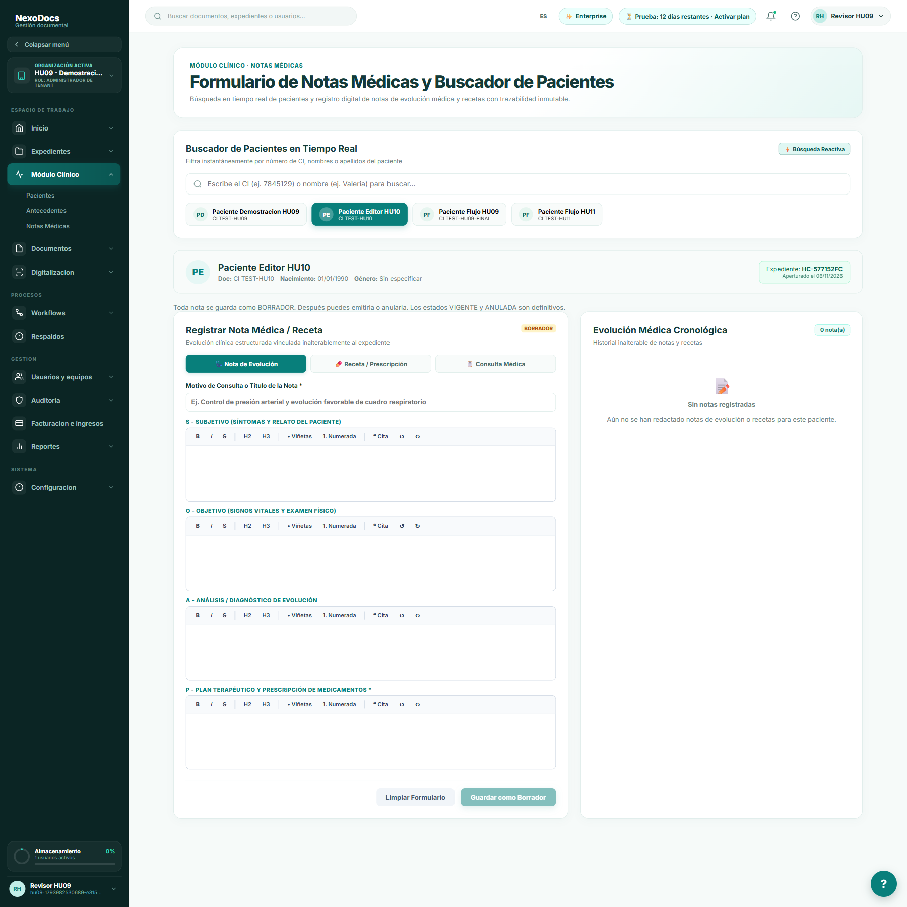
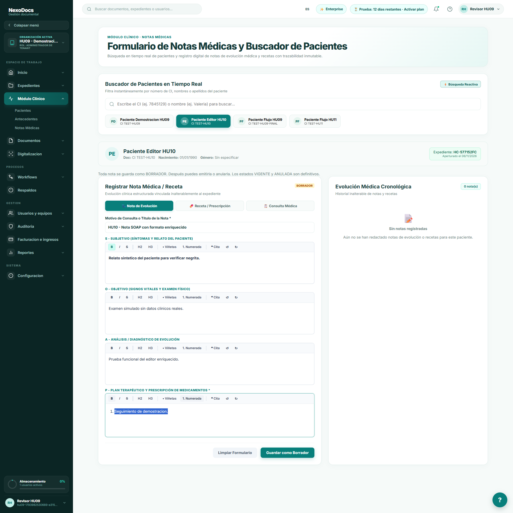
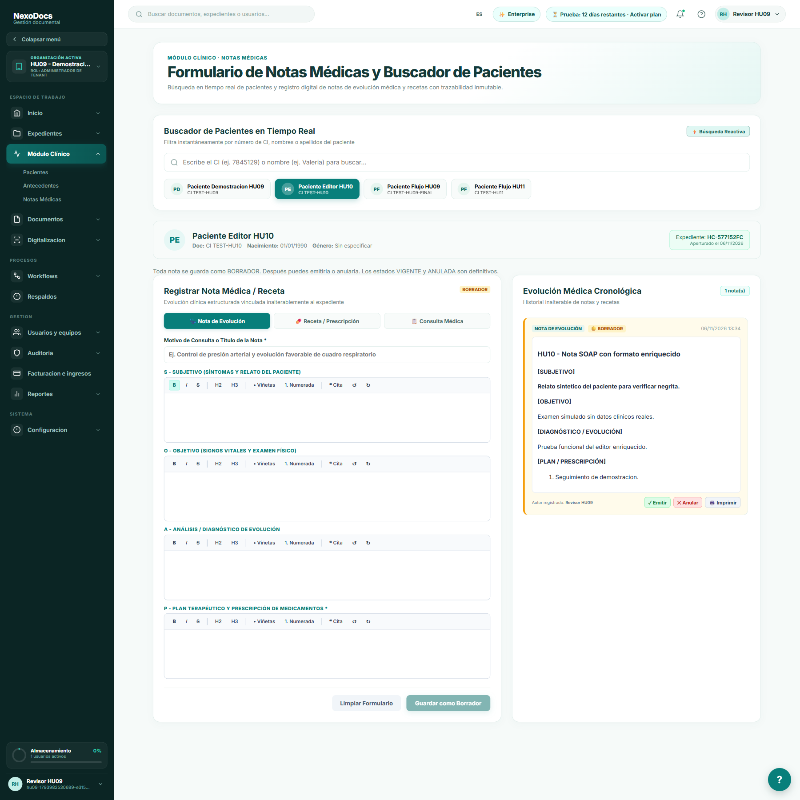
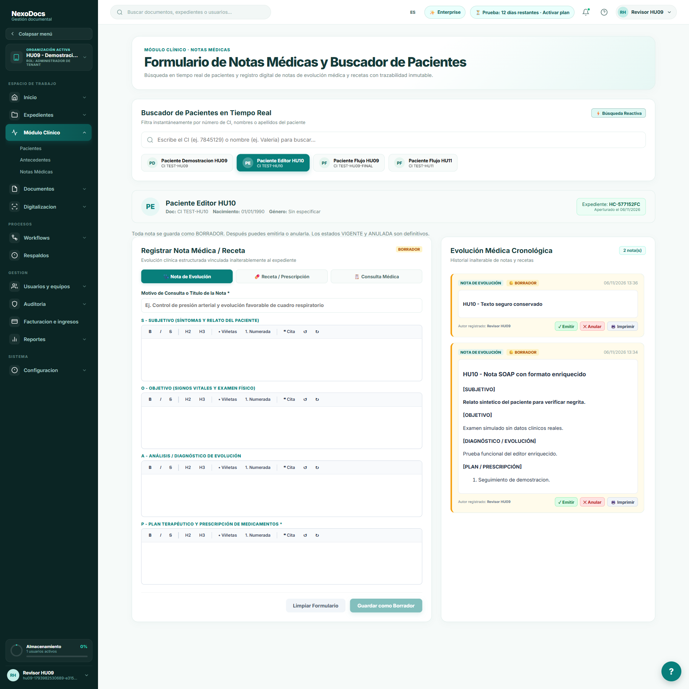

# HU-10: editor SOAP y sanitización XSS

Ensayo local del 2026-11-06 sobre `91fb767` y cambios sin commit. Se usó el paciente sintético Editor HU10, dentro de la base desechable de las pruebas anteriores. Capturas completas de la página real, sin recortar, sin editar imágenes y sin respuestas HTTP simuladas.

1. **Abrir la pantalla:** se comprobaron cuatro componentes TipTap, uno por campo SOAP.

2. **Redactar con formato:** se escribieron los cuatro campos, se activó Negrita desde la barra del primer editor y Lista numerada en Plan.

3. **Guardar:** POST respondió 201; el HTML devuelto y persistido contiene strong y ol. La nota aparece en la evolución clínica con el formato aplicado.

4. **Sanitización y recarga:** se envió HTML con un párrafo seguro, script, iframe y atributos onload/onerror por API para evitar que el editor limpiara primero el payload. Spring Boot guardó únicamente el párrafo seguro con strong. Al recargar se muestra ese texto y el marcador de ejecución del script permanece falso.

El HTML exclusivamente malicioso fue rechazado con HTTP 400 y el número de notas se mantuvo igual. También se comprobó el caso script más p/br vacío: ahora se rechaza en lugar de guardar una nota visualmente vacía. [Payloads y resultados HTTP](api-results.json).

PostgreSQL confirmó dos notas y que ninguna contiene etiquetas script/iframe ni atributos onload/onerror. Estas pruebas no certifican seguridad absoluta frente a cualquier ataque; verifican los criterios concretos de la HU y la lista permitida de Jsoup.

Pruebas Maven: HtmlSanitizerServiceTest (6) y MedicalNoteServiceTest (25), todas aprobadas. Backend empaquetado, desplegado y comprobado localmente. No se hizo push ni se desplegó en AWS.
