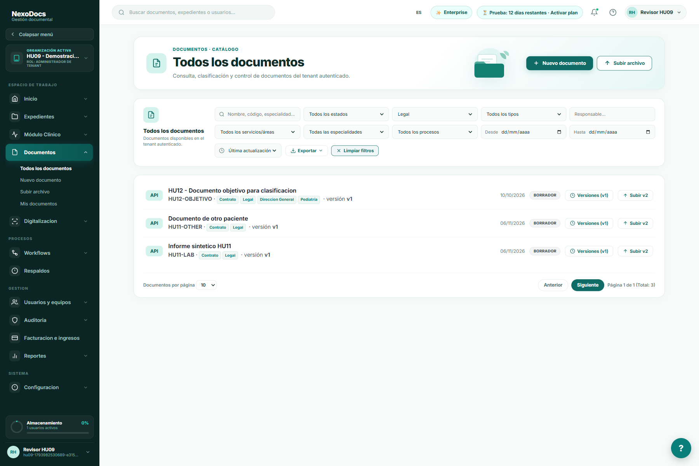
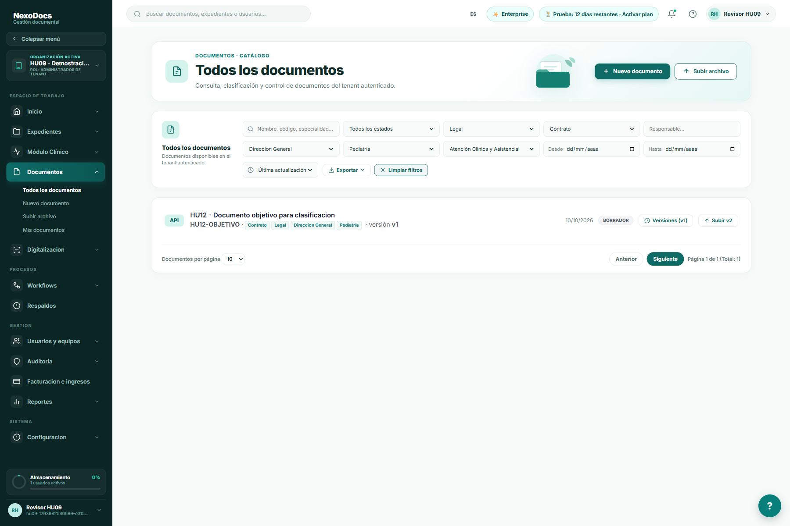
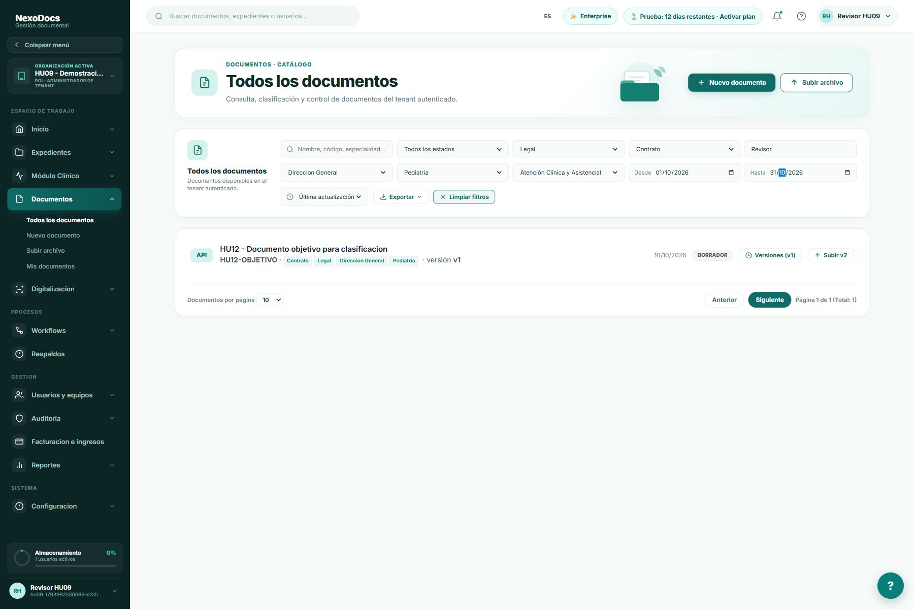
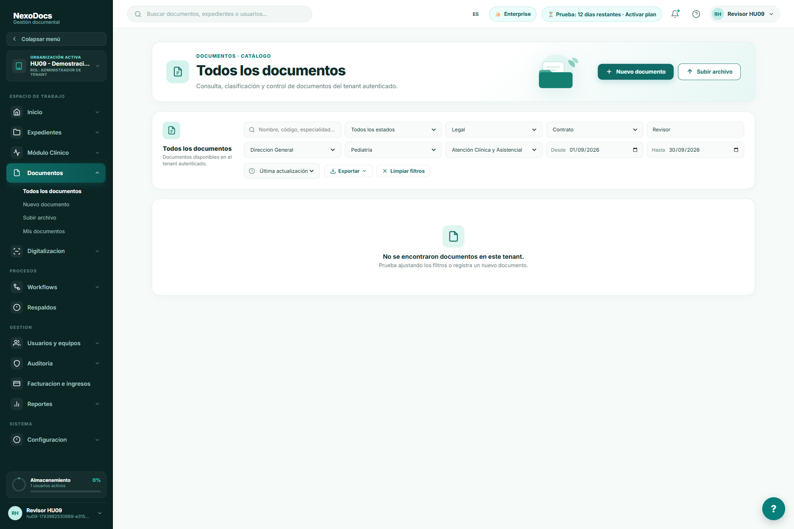
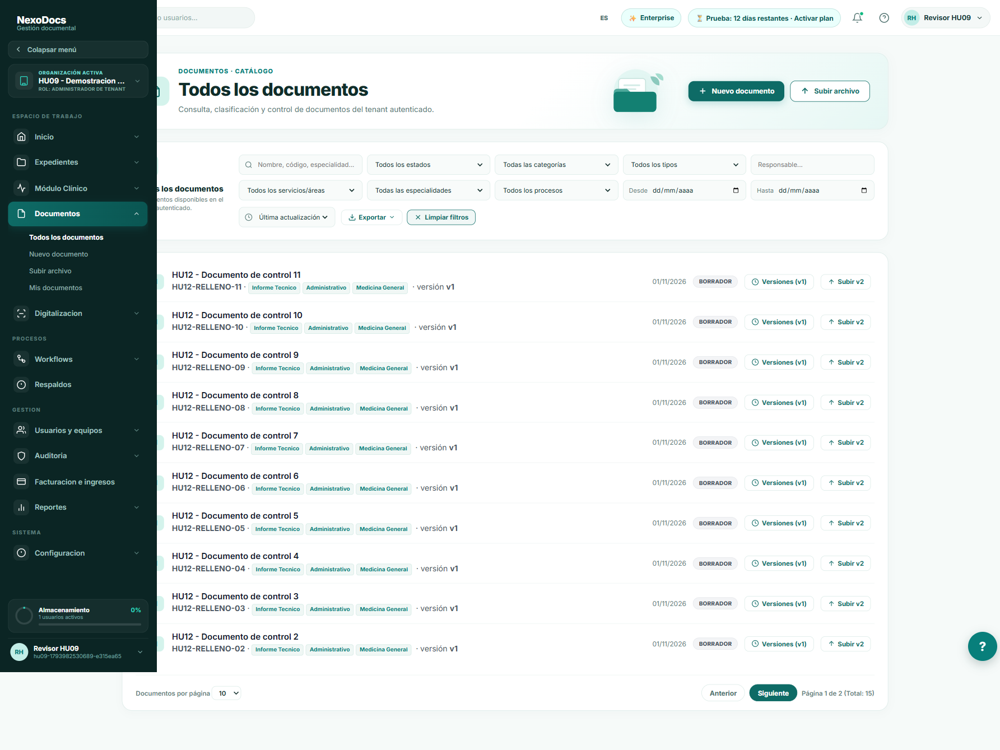

# HU-12: clasificación documental

Ensayo local del 2026-11-06 sobre `91fb767` y cambios sin commit. Se usó la organización sintética de las pruebas anteriores, con 15 documentos de control. Capturas completas de la página real, sin recortar ni editar imágenes.

1. **Repositorio paginado:** el documento objetivo se creó antes de doce documentos de relleno, por lo que no estaba en la página inicial ordenada por actualización.

2. **Seleccionar categoría:** el servidor filtra antes de paginar y devuelve los documentos de la categoría Legal.

3. **Combinar clasificación:** tipo Contrato, servicio Dirección General, especialidad Pediatría y proceso Atención Clínica y Asistencial. El documento objetivo aparece aunque originalmente estaba fuera de la página cargada.

4. **Agregar responsable y fechas:** Revisor y octubre de 2026. La consulta completa devuelve un único documento y total 1.

5. **Probar un rango sin coincidencias:** septiembre muestra un estado vacío real, con cero resultados.

6. **Limpiar filtros:** vuelve el listado completo paginado.

## Comprobaciones

Se probaron por HTTP categoría, tipo documental, departamento, especialidad, proceso, responsable y ambos extremos de fecha. Todos encontraron el documento objetivo. La combinación completa con tamaño de página 1 devolvió exactamente ese documento; una especialidad inexistente devolvió total 0; el rango invertido devolvió 400. Los límites de fecha son inclusivos. [Resultados reales](api-results.json).

La corrección mueve filtros y orden desde la página cargada en Angular a una Specification JPA, conservando tenant, estado, bajas y permisos. La pantalla cancela consultas anteriores cuando cambian los filtros. La API mantiene el alcance de Mis documentos y Compartidos.

Pruebas Maven: DocumentServiceTest (3), DocumentSearchSpecificationTest (3) y FormComponentEnforcementTest (3), aprobadas; cuatro comprobaciones estructurales de documentos en frontend aprobadas. Build Angular de producción correcto, con advertencias existentes. Estas pruebas no equivalen a probar todos los perfiles ni todos los módulos.

Sin migraciones SQL nuevas. No se hizo commit, push ni despliegue en AWS. Los filtros actúan sobre el conjunto completo; la exportación existente sigue exportando la página cargada y queda fuera del alcance de esta HU.
