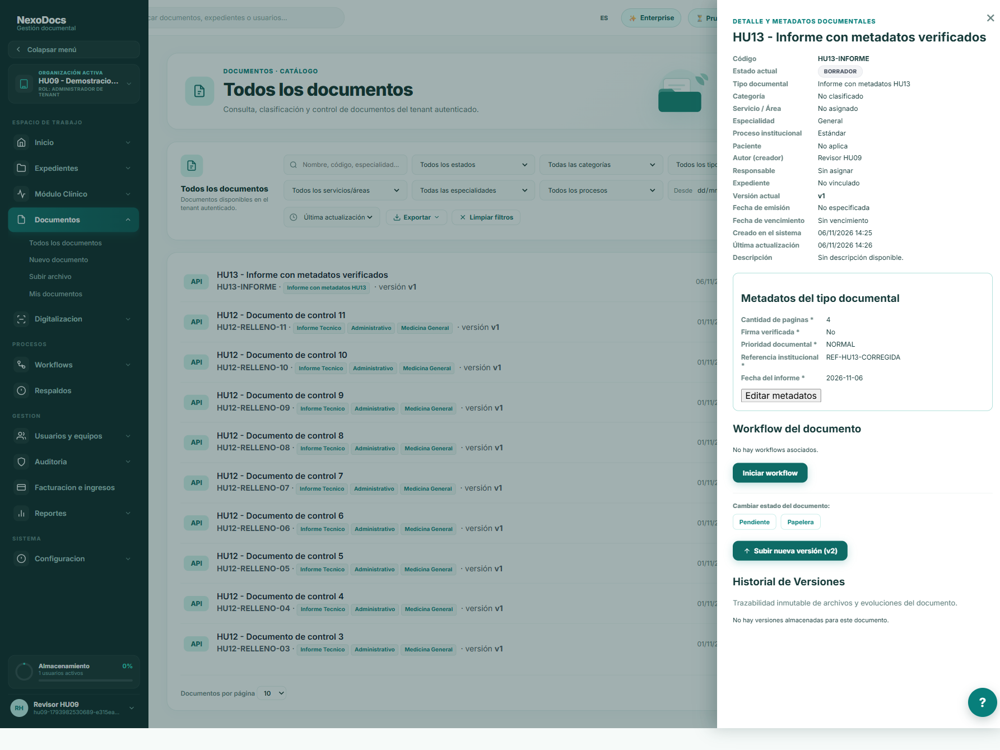
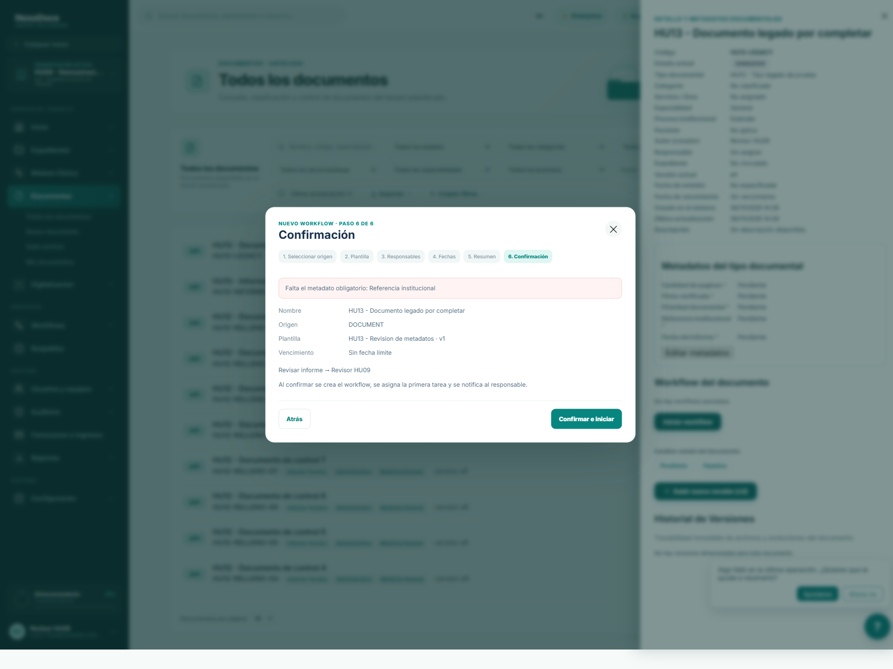
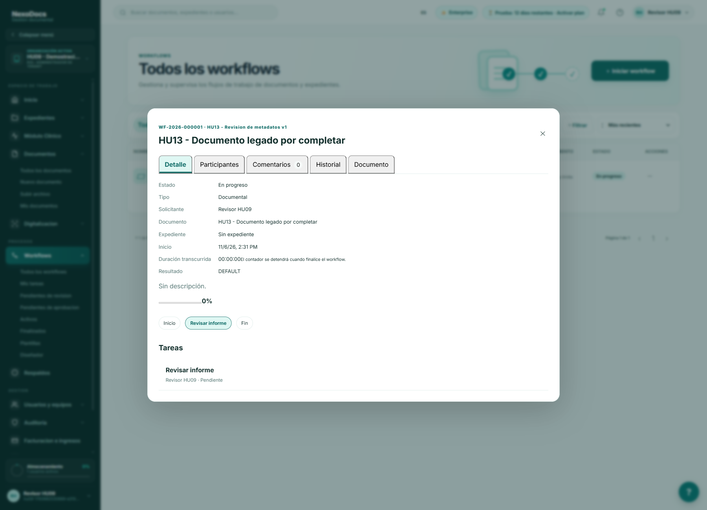

# HU-13: metadatos documentales

Verificación local del 2026-11-06 sobre `91fb767` más cambios sin commit. Se reutilizó la organización sintética de HU-09 y su base desechable. No se utilizaron pacientes reales ni se operó AWS. Las imágenes son capturas completas de la página, obtenidas con Chromium/Playwright, sin recortar ni simular respuestas.

## Paso a paso

1. [Seleccionar el tipo documental](01-metadatos-obligatorios.png). El formulario genera cinco campos obligatorios desde el esquema recibido del backend: referencia, fecha del informe, cantidad de páginas, firma verificada y prioridad.
2. [Intentar guardar sin completarlos](02-rechazo-campos-vacios.png). La pantalla muestra el campo faltante. Los intentos directos por API con campos faltantes, fecha imposible, tipo incorrecto u opción desconocida respondieron 400; no crearon documentos.
3. [Completar metadatos](03-metadatos-completos.png). La creación respondió 201 y devolvió los datos guardados, incluido `false` como valor válido para firma verificada.
4. [Consultar el documento](04-detalle-desde-backend.png). Se muestran los metadatos recuperados junto al estado, versión, autor, clasificación y fechas del documento.
5. [Corregir valores](05-edicion-metadatos.png). PATCH /metadata respondió 200.
6. [Recargar](06-persistencia-al-recargar.png). Referencia corregida y cuatro páginas permanecen guardadas. PostgreSQL confirmó páginas como número y firma como booleano false.
7. [Documento antiguo incompleto](07-legado-con-metadatos-pendientes.png). Para reproducir el caso se creó un documento con un tipo sin requisitos y después se añadieron los requisitos al tipo de prueba. Los valores faltantes aparecen como Pendiente.
8. [Intentar iniciar un workflow](08-workflow-rechazado.png). El asistente llegó al paso de confirmación y la API respondió 400: falta Referencia institucional. No creó un workflow.
9. [Completar el documento antiguo](09-legado-corregido.png). La edición guardó sus cinco metadatos.
10. [Confirmar el mismo recorrido](10-confirmacion-con-metadatos-validos.png).
11. [Workflow creado](11-workflow-iniciado.png). POST respondió 201, estado IN_PROGRESS, y se asignó la tarea Revisar informe al usuario de prueba. El documento pasó a IN_REVIEW.
12. [Intentar editar durante la revisión](12-edicion-bloqueada-con-workflow.png). Backend y pantalla rechazaron el cambio con HTTP 409; el valor guardado no cambió.
13. [Verificación final](13-verificacion-final.png). Con frontend y backend actualizados, el documento editable volvió a guardarse con HTTP 200 y devolvió su identificador de estado actualizado.

[Resultados HTTP y valores recuperados](api-results.json). Los rechazos se probaron con solicitudes reales al backend; no se sustituyó la respuesta con datos de demostración en la interfaz.

## Implementación

- DocumentMetadataValidator aplica los requisitos del tipo antes de persistir y antes de iniciar el workflow. Comprueba requeridos, tipos, fechas, enum, longitudes y límites numéricos; cero y false no se consideran vacíos.
- DocumentService permite actualizar metadatos con document:update, conserva claves omitidas, respeta componentes protegidos y bloquea la fila para coordinarse con el inicio de workflows. No permite editar con workflow activo ni en ARCHIVED, VOIDED o TRASHED.
- Angular genera los campos a partir de metadataSchema, convierte números y JSON, muestra el detalle y permite corregir documentos anteriores. La respuesta del backend sigue siendo la autoridad.
- No se cambió el esquema SQL ni se reescribieron documentos existentes.

## Pruebas y límites

44 pruebas seleccionadas aprobadas: validador de metadatos (10), persistencia de metadatos (5), componentes de documentos (3), lecturas de campos ocultos (8), documentos (3), filtros (3), permisos de componentes (3) y grafos de workflows (9). Las pruebas de persistencia incluyen rechazos sin guardar, conservación de claves omitidas y bloqueo con workflow activo. El build de producción Angular y el empaquetado del backend terminaron correctamente; cuatro comprobaciones estructurales del frontend también pasaron.

La compilación global de pruebas encontró dos llamadas anteriores a upload con tres argumentos en HiddenComponentsRemainingPathsTest, mientras el código de versionado que se está modificando exige cuatro. Para la última verificación de este grupo se compilaron sus clases con javac y el classpath Maven y se ejecutaron con Surefire. No se presenta la suite completa como aprobada.

El contrato implementado es plano: object/array validan solo su tipo superior; no implementa todas las palabras clave de JSON Schema ni validación recursiva. El flujo probado usa una plantilla simple de revisión con responsable elegido en el asistente. No certifica todos los tipos, perfiles o plantillas de producción, ni el aprovisionamiento automático de tenants. La configuración del tenant sintético sigue generando un aviso ajeno al flujo clínico/documental, que se cerró desde la interfaz cuando no estaba detrás de un modal.

El despliegue local actualiza los archivos de los contenedores existentes conservando su configuración. No se hizo commit, push ni despliegue en AWS.
