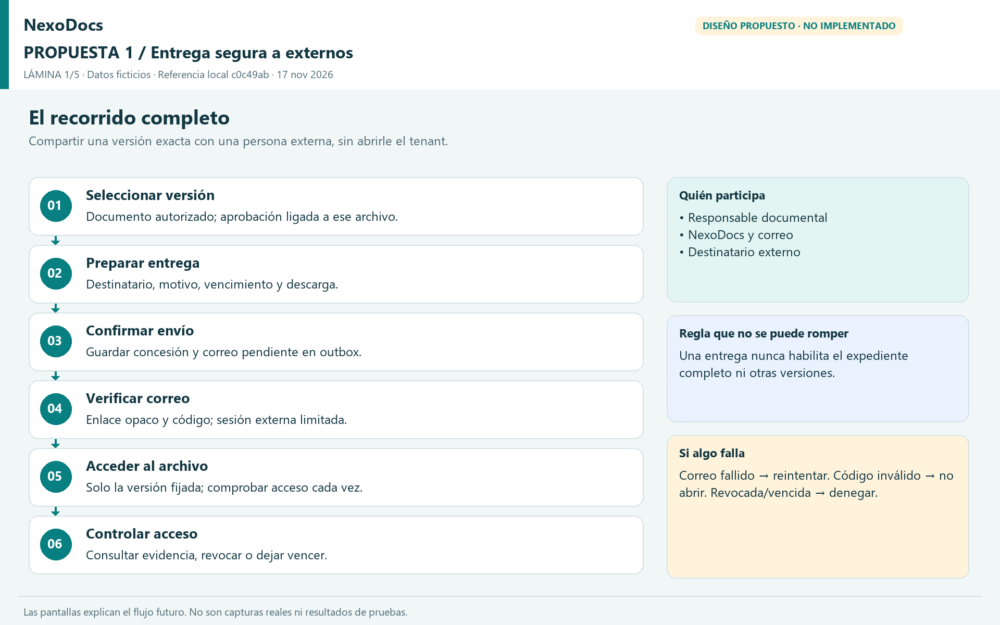
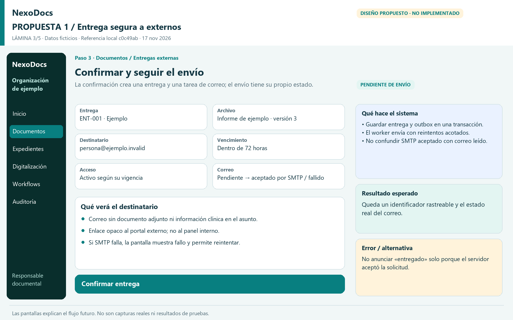
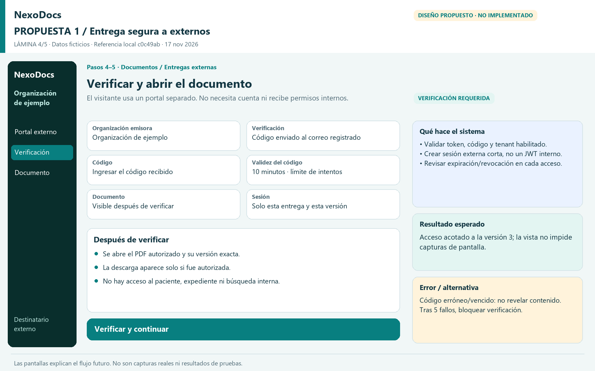

# P01: entrega documental segura a destinatarios externos

> **Actualizacion 2026-11-17:** este archivo conserva el diseno original. Ya existe implementacion local; consultar [contratos, configuracion y limites actuales](../04-dominio-y-negocio/operaciones-documentales.md). Las imagenes siguen siendo conceptuales; las APIs propuestas no sustituyen las rutas reales.
> **Actualizacion 2026-11-17:** este archivo conserva el diseno original. Ya existe implementacion local; consultar [contratos, configuracion y limites actuales](../04-dominio-y-negocio/operaciones-documentales.md). Las imagenes siguen siendo conceptuales. Las APIs propuestas de este diseno no sustituyen las rutas reales documentadas.
> Revisión documental: 2026-11-17. Referencia: `c0c49ab` más cambios locales. Propuesta no implementada. Las pantallas y datos son ilustrativos.

**Como** responsable documental, **quiero** entregar una versión concreta a un destinatario externo identificado, **para** compartir información con acceso limitado, vencimiento y trazabilidad.

Ejemplo: una organización entrega el informe ficticio `INF-001`, versión 3, a `persona@ejemplo.invalid`. El destinatario no necesita licencia ni cuenta interna. El enlace nunca concede acceso a la organización, paciente, expediente completo o versiones diferentes.

## Recorrido paso a paso

### 1. Elegir documento y versión

Desde Documentos → detalle → Historial de versiones, el operador selecciona una versión y pulsa **Entregar a externo**. Ve su nombre, fecha, tamaño y estado. En el MVP solo se admiten versiones vinculadas a una aprobación/vigencia válida para esa versión, con archivo íntegro; no basta el estado actual del documento si la aprobación correspondía a otro archivo. Si esa correspondencia no puede comprobarse, se bloquea la entrega con un motivo.

### 2. Definir destinatario y condiciones

Un drawer pide nombre, correo, motivo, vencimiento y posibilidad de descargar. Una entrega corresponde a un destinatario y una versión; para tres destinatarios se crean tres entregas independientes. Propuesta inicial: vencimiento predeterminado 72 horas, máximo 7 días configurable por tenant; nunca duración infinita por defecto.

### 3. Confirmar y enviar

Antes de confirmar se muestra un resumen y se comprueba permiso nuevo `document:deliver`, lectura de esa versión y autorización de compartir sus datos. El permiso de entrega no puede saltarse campos ocultos ni autorizaciones clínicas; si el usuario no puede divulgar el archivo completo, no puede enviarlo por esta vía.

El servidor crea la entrega y una tarea de correo en la misma transacción mediante outbox. La interfaz distingue **pendiente de envío**, **aceptado por SMTP** y **fallido**. Un envío aceptado por SMTP no prueba recepción en la bandeja del destinatario. El correo lleva un enlace opaco, no el archivo adjunto ni datos clínicos en el asunto.

El material secreto necesario para construir el correo se genera al enviar o se conserva cifrado de forma transitoria en el outbox, con borrado tras envío/vencimiento. Guardar solo el hash del token en la concesión no basta para reconstruir el enlace en un reintento; implementar ese circuito explícitamente, sin dejar tokens en texto plano en la cola o respaldos descargables.

### 4. Verificar el correo del visitante

El visitante abre `/external/deliveries/...` fuera del shell interno. El sistema no muestra nombre del documento ni datos sensibles antes de verificar. El enlace se intercambia por una sesión externa corta y se limpia de la barra de dirección; sin recursos de terceros ni URL en logs. Se envía un código al correo registrado, con validez propuesta de 10 minutos, máximo 5 intentos y límite de reenvíos.

Esto demuestra control de ese buzón, no identidad legal ni un segundo factor independiente: enlace y código llegan al mismo canal. Para entrega clínica de mayor sensibilidad se debe definir una verificación adicional antes de habilitarla.

### 5. Ver o descargar la versión autorizada

Con la verificación completa se muestra solo la versión fijada. La sesión externa no es un JWT interno y no puede consultar `/documents`, `/patients` o `/expedients`. Cada acceso al contenido vuelve a verificar entrega, versión, tenant habilitado, vencimiento y revocación. No se exponen rutas del volumen.

El modo de visualización restringida se limita inicialmente a PDF e imágenes compatibles. No prometer que esconder el botón impide copiar, capturar o recuperar bytes ya enviados al navegador. DOCX no se ofrece como vista restringida sin un renderizado seguro implementado.

### 6. Consultar seguimiento o revocar

Documentos → **Entregas externas** muestra destinatario, versión, estado, último acceso y descargas. La acción **Revocar** exige permiso, confirmación y motivo. Invalida sesiones y nuevas solicitudes; no recupera copias descargadas ni garantiza cortar bytes de una respuesta ya en curso.

### 7. Vencimiento, nueva versión y restauración

El vencimiento se comprueba al acceder, aunque el scheduler esté caído. Una versión nueva no cambia la entrega existente. Si se anula o retira una versión, se invalidan sus entregas. Restaurar un respaldo debe cerrar sesiones externas y revocar las entregas afectadas, nunca reactivar enlaces expirados o revocados; una nueva entrega requiere nueva autorización.

## Recorrido visual

## Estados separados

| Dimensión | Valores propuestos |
|---|---|
| Acceso | ACTIVE, REVOKED, EXPIRED |
| Correo | PENDING, SMTP_ACCEPTED, FAILED |
| Verificación | PENDING, VERIFIED, LOCKED |

Una entrega puede estar activa y todavía pendiente de correo; la UI debe mostrar ambas dimensiones. Registrar fecha de vencimiento en UTC y mostrar zona del tenant. No derivar el estado del texto de un badge.

## Qué desarrollar

| Capa | Trabajo nuevo |
|---|---|
| Angular | Drawer de entrega, lista/detalle, revocación, portal externo accesible y responsive, estados de envío/código/fallo |
| Spring | `ExternalDeliveryService`, autorización por versión, sesiones externas, OTP, outbox y streaming controlado |
| Persistencia | `external_deliveries`, destinatario, vínculo tenant/document/version, intentos OTP, eventos y outbox; almacenar hashes de tokens/códigos, nunca valores reutilizables |
| Acceso público | Resolución opaca mínima token-hash → tenant/entrega, compatible con bases aisladas; no aceptar tenantId del visitante |
| Permisos nuevos | `document:deliver`, `delivery:read`, `delivery:revoke`; lectura interna del documento sigue siendo requisito |
| Auditoría | Creación, envío, verificación, acceso externo, descarga y revocación; actor externo explícito, sin inventar un usuario interno |

La RLS actual exige usuario interno válido. Hace falta una función/identidad externa estrictamente acotada a una entrega y versión, con grants mínimos y sin acceso a tablas generales. La migración debe extender auditoría para distinguir actor externo de usuario interno sin modificar eventos antiguos. El directorio central guarda solo la referencia necesaria para enrutamiento, sin nombres de documentos ni contenido clínico.

**API propuesta, inexistente hoy:** `POST /api/v1/documents/{id}/deliveries`, `GET /api/v1/deliveries`, `POST /api/v1/deliveries/{id}/revoke`; endpoints públicos acotados de intercambio de enlace, solicitud/verificación de código y contenido. Creación devuelve 202 con estado de envío; no «correo entregado».

## Reglas de seguridad y recuperación

- HTTPS obligatorio en esta función; el HTTP temporal de EC2 no sirve para probar credenciales ni documentos reales.
- Cookies externas Secure/HttpOnly/SameSite, CSRF donde corresponda, rate limiting, `Cache-Control: no-store` y `Referrer-Policy: no-referrer`.
- Token aleatorio de alta entropía, hash en persistencia, nunca en logs; reenvío de correo no crea concesiones más amplias.
- Revocar si se desactiva al emisor o pierde autorización de compartir; revisar cambios de permisos en cada acceso mediante la concesión y política vigente.
- La aprobación del workflow y la verificación de correo no equivalen a firma digital o recepción legal certificada.
- Las concesiones, revocaciones y evidencia deben conservarse fuera del rebobinado operativo de restauraciones; probar también borrado/cierre del tenant y limpieza del directorio central.

## Criterios de aceptación y pruebas

1. Emisor autorizado crea una entrega sobre una versión aprobada exacta y la recibe el destinatario ficticio en el entorno de pruebas.
2. Código erróneo, vencido o de otra entrega no habilita contenido; la respuesta no permite enumerar destinatarios.
3. Alterar documento, versión o tenant devuelve denegación genérica sin filtrar existencia.
4. Expirar/revocar bloquea solicitudes nuevas incluso con sesión externa abierta; la caché no permite recuperar una copia desde otra sesión.
5. Subir una versión posterior no cambia lo entregado. Anular el documento invalida su acceso externo.
6. Caída SMTP muestra pendiente/fallo y reintenta sin duplicar entregas; auditoría no contiene enlace ni código.
7. Restaurar un respaldo no resucita enlaces; probar en tenant compartido y aislado, con runtime real.

Dependencias: política de divulgación del tenant, SMTP confiable y HTTPS. La infraestructura de correo existente se debe inspeccionar y ampliar; no asumir un servicio genérico de entrega ya operativo. [Diseño común y fuentes oficiales](README.md).
