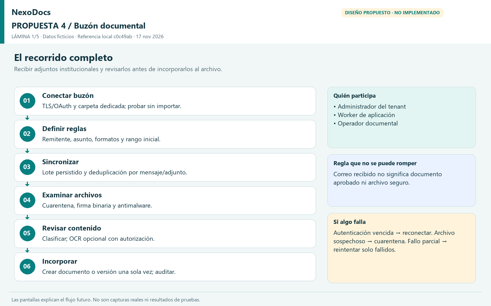
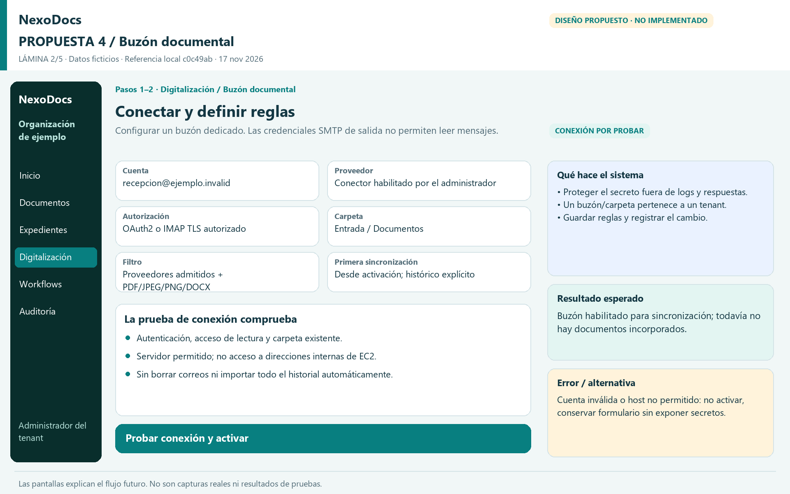
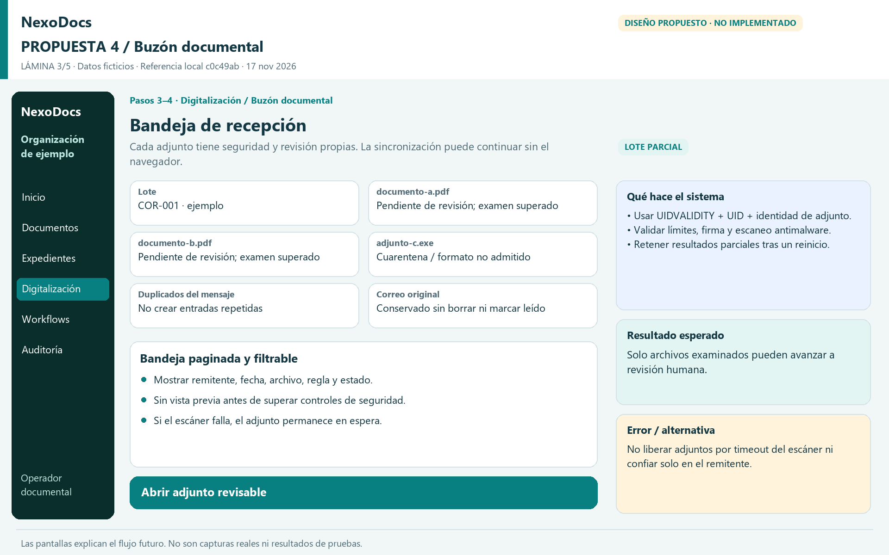
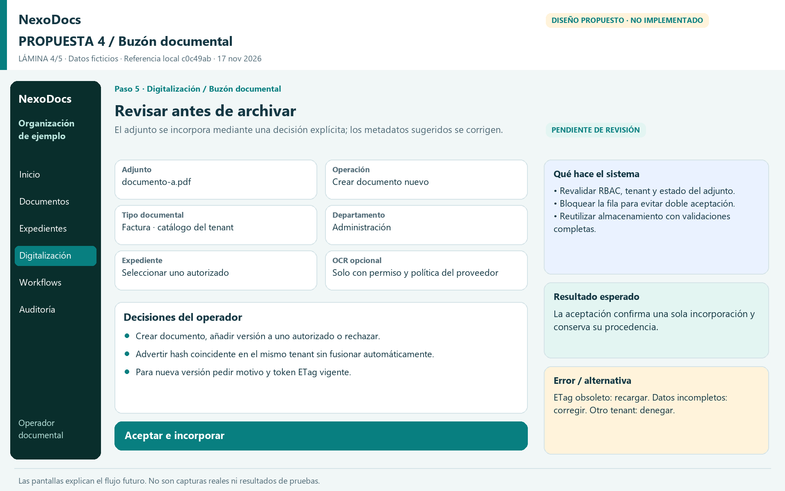
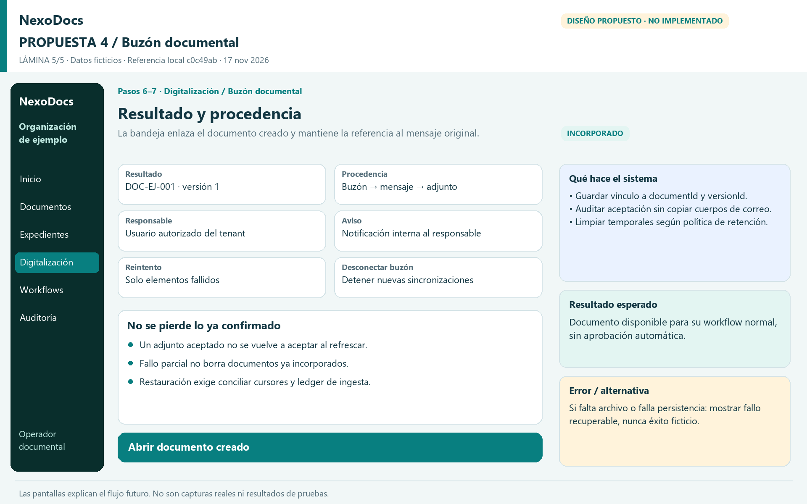

# P04: incorporación documental desde correo

> **Actualizacion 2026-11-17:** este archivo conserva el diseno original. Ya existe implementacion local; consultar [contratos, configuracion y limites actuales](../04-dominio-y-negocio/operaciones-documentales.md). Las imagenes siguen siendo conceptuales; las APIs propuestas no sustituyen las rutas reales.
> **Actualizacion 2026-11-17:** este archivo conserva el diseno original. Ya existe implementacion local; consultar [contratos, configuracion y limites actuales](../04-dominio-y-negocio/operaciones-documentales.md). Las imagenes siguen siendo conceptuales. Las APIs propuestas de este diseno no sustituyen las rutas reales documentadas.
> Revisión documental: 2026-11-17. Referencia: `c0c49ab` más cambios locales. Propuesta no implementada; no se ha conectado ningún buzón ni se han importado correos.

**Como** encargado de recepción, **quiero** incorporar adjuntos de un buzón institucional a una bandeja de revisión, **para** registrarlos sin descargar y subir archivos manualmente.

Ejemplo ficticio: llegan tres adjuntos a un buzón de proveedores. El sistema detecta dos PDF y una imagen, los revisa y permite clasificar cada uno como documento nuevo o nueva versión. Un correo no implica que sus adjuntos ya estén autorizados o aprobados.

## Recorrido paso a paso

### 1. Habilitar el módulo y conectar un buzón

Digitalización → **Buzón documental**. Un administrador con nuevo permiso `mailbox:manage` agrega una cuenta y carpeta. MVP: un buzón dedicado por tenant, un conector real y configurable. Preferencia: OAuth2 según proveedor; si se admite IMAP con contraseña de aplicación, TLS obligatorio y secreto cifrado/referenciado fuera de respuestas y logs. La configuración SMTP actual es de salida y no permite leer correos.

El botón **Probar conexión** verifica autenticación, carpeta, permisos de lectura y disponibilidad; no importa documentos. La misma cuenta/carpeta no se asigna a dos tenants en el MVP. El usuario no puede escribir un host arbitrario que permita consultar metadatos de EC2 o servicios internos: aplicar allowlist y validación de DNS/red, también tras redirecciones/reintentos.

### 2. Crear reglas de recepción

Se configuran remitentes admitidos, carpeta, asunto opcional, formatos aceptados y destino sugerido. Cada regla muestra ejemplos que coinciden antes de activarse. La primera sincronización procesa desde la activación; importar histórico requiere rango de fechas y límite de mensajes explícitos. No descargar un buzón completo por defecto.

Un remitente admitido es un filtro operativo, no prueba suficiente de autenticidad: el campo From puede falsificarse. Mantener revisión humana y, cuando el proveedor lo permita, mostrar verificaciones de correo obtenidas de una fuente confiable, sin confiar en cabeceras arbitrarias.

### 3. Sincronizar con un trabajo persistido

El backend registra un lote y un worker no privilegiado consulta mensajes nuevos. El cursor usa identidad del buzón, carpeta, UIDVALIDITY y UID de IMAP; Message-ID solo es auxiliar. Una restricción única evita duplicar un adjunto del mismo mensaje. SHA-256 permite advertir coincidencias en el mismo tenant, pero no descartar automáticamente un archivo que puede tener otro significado.

El MVP no borra, mueve ni marca como leído el mensaje original. Los errores se muestran por lote y adjunto; una caída no obliga a empezar desde cero. Recuperar una copia antigua del sistema tampoco debe reimportar silenciosamente mensajes ya aceptados: conservar un ledger mínimo de ingestión no rebobinable y conciliar cursores.

### 4. Examinar archivos antes de habilitar su uso

Cada adjunto entra en cuarentena, sin vista previa hasta pasar controles. Validar tamaño, firma binaria, MIME y límites de páginas; integrar un escáner antimalware con salida de error explícita. El servidor hoy valida ciertas firmas, pero eso no sustituye un antivirus. Si el escáner no está disponible, el adjunto queda en espera; no marcarlo limpio por omisión.

MVP: admitir formatos compatibles con almacenamiento/OCR, rechazar ejecutables, ZIP adjuntos y archivos cifrados o protegidos. Limitar cantidad/tamaño total de adjuntos, MIME anidado, tiempo y memoria. No ejecutar macros, enlaces, HTML del correo ni contenido activo del PDF.

### 5. Revisar y corregir metadatos

La bandeja muestra remitente, fecha, nombre, estado de seguridad, tipo sugerido y procedencia. El operador elige **Crear documento**, **Añadir versión** o **Rechazar**. Puede ejecutar el OCR existente si tiene los permisos necesarios y el tenant habilitó el proveedor externo; recibir un correo no autoriza enviar su contenido a Gemini.

El formulario reutiliza tipos, departamentos, pacientes y expedientes autorizados. Un dato extraído es sugerencia; no crea pacientes ni asociaciones automáticamente. Los usuarios sin permiso para un expediente no pueden asignarlo con un UUID pegado.

### 6. Incorporar al archivo y avisar

Al aceptar, una transacción reclama el adjunto pendiente y crea una sola vinculación al documento/versión. El almacenamiento adopta el archivo mediante un punto de integración que repita validaciones, tenant, hash y auditoría; no copiar rutas arbitrarias. Si es nueva versión, aplicar los controles existentes de ETag, motivo, estado y workflow. El cliente debe recargar tras 412 en vez de sobrescribir.

Confirmada la operación, queda un enlace desde la bandeja al documento y un aviso interno al responsable. No se envía una respuesta externa automática en el MVP. Si falla el almacenamiento se conserva el adjunto recuperable y se informa el resultado, sin anunciar un documento completado inexistente.

### 7. Retención y reintentos

Configurar vencimiento de adjuntos rechazados y cuarentena. La retención no borra el documento ya incorporado ni su evidencia mínima. Desconectar un buzón detiene sincronizaciones nuevas, revoca credenciales y conserva el historial. La baja del operador requiere reasignar el responsable interno; los jobs no heredan permisos de un usuario ya desactivado.

## Recorrido visual

## Estados y contratos propuestos

| Objeto | Estados |
|---|---|
| Buzón | DISCONNECTED, CONNECTED, PAUSED, AUTH_ERROR |
| Lote | QUEUED, RUNNING, COMPLETED, PARTIAL, FAILED |
| Adjunto | RECEIVED, SCAN_PENDING, QUARANTINED, REVIEW_PENDING, IMPORTING, IMPORTED, REJECTED, FAILED |

Estados de OCR se conservan en OcrJob; no crear equivalencias falsas entre adjunto aceptado y OCR indexado. El registro de procedencia vincula ambos cuando corresponda.

**API nueva propuesta:** `POST /api/v1/mailboxes`, `POST /mailboxes/{id}/test`, `PUT /mailboxes/{id}/rules`, `POST /mailboxes/{id}/sync` (202), `GET /mail-intake/items`, `POST /mail-intake/items/{id}/accept`, `POST /mail-intake/items/{id}/reject` y consulta/reintento de lotes. No existen hoy.

## Qué implementar

- Angular: conexión, reglas, historial de lotes, bandeja paginada, vista segura de adjunto, resolución de duplicados y aceptación individual.
- Backend: adaptador de correo, parser MIME, validador de red/SSRF, escáner, scheduler, outbox/cola, idempotencia y servicio de aceptación con bloqueo de fila.
- Nuevas tablas: `mailbox_connections`, `mailbox_rules`, `mail_sync_runs`, `mail_messages`, `mail_attachments`, procedencia y ledger mínimo. FKs/RLS por tenant; referencias centrales de enrutamiento solo cuando sean necesarias.
- Permisos propuestos: `mailbox:manage`, `mail-intake:read`, `mail-intake:accept`, `mail-intake:reject`. Aceptar exige además permiso real de crear documento o versión; OCR exige sus permisos existentes.
- Almacenamiento: cuarentena separada bajo alcance del tenant, permisos restrictivos y sin URL pública. Respaldar pendientes útiles y definir qué metadatos de conexión se pueden recuperar; credenciales no se incluyen en ZIP descargables.
- Auditoría: conexión/desconexión, cambios de reglas, aceptación, rechazo y fallos operativos relevantes; no cuerpos de mensajes, adjuntos ni valores de autenticación. El listado rutinario no genera un evento por click.

## Criterios de aceptación y pruebas

1. Correo ficticio con dos adjuntos válidos produce dos pendientes; procesarlo de nuevo no los duplica.
2. Dos aceptaciones simultáneas generan una única versión/documento y una respuesta de conflicto para la segunda.
3. Un archivo malicioso, protegido o con tipo falso no se visualiza ni incorpora; una caída del escáner no lo libera.
4. Una cuenta vencida muestra AUTH_ERROR y permite reconectar sin perder cursor/procedencia.
5. Un fallo parcial de lote conserva los documentos aceptados y permite reintentar solo fallidos.
6. Ningún adjunto/expediente de otro tenant puede consultarse, asignarse ni deduplicarse revelando su existencia.
7. Restaurar el tenant no reimporta adjuntos ya consolidados ni rebobina eventos externos; probar reconciliación.

Dependencias: un proveedor de correo y su método de autorización, biblioteca MIME/IMAP compatible, antivirus y recursos de procesamiento. No está cubierto por tener Mailtrap SMTP. [Diseño común y referencias](README.md).
