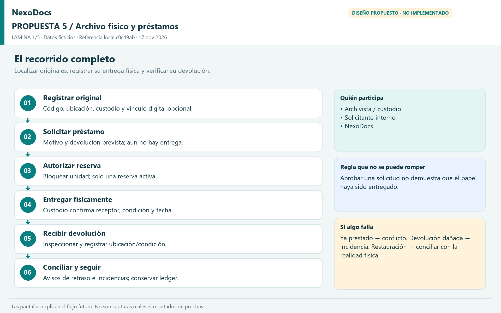
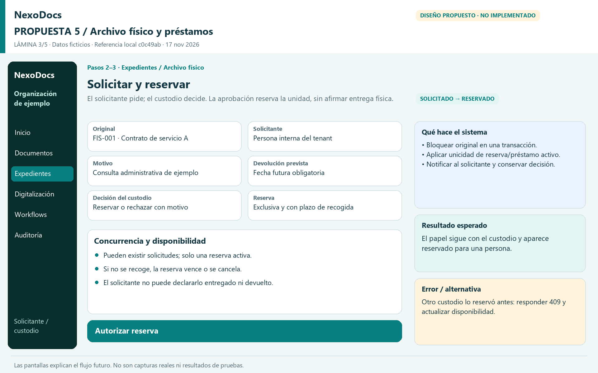
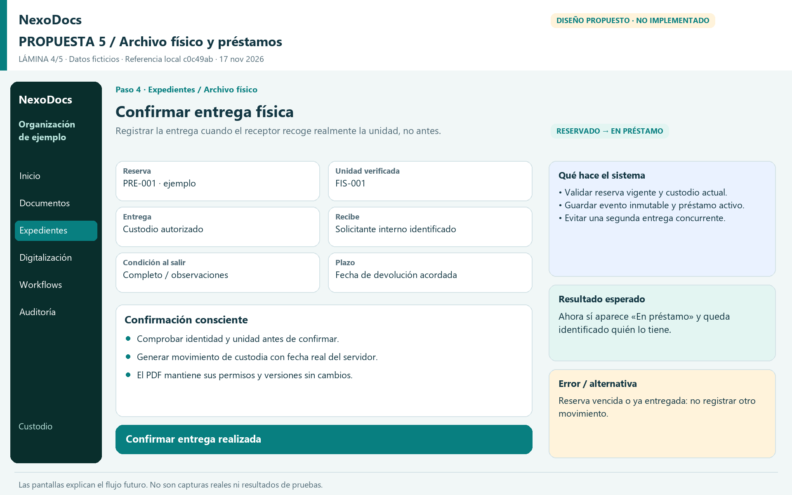
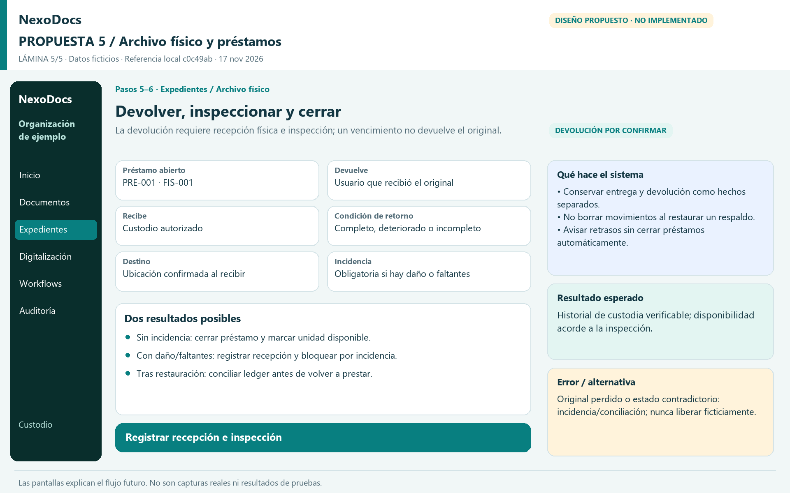

# P05: ubicación y préstamo de originales físicos

> **Actualizacion 2026-11-17:** este archivo conserva el diseno original. Ya existe implementacion local; consultar [contratos, configuracion y limites actuales](../04-dominio-y-negocio/operaciones-documentales.md). Las imagenes siguen siendo conceptuales; las APIs propuestas no sustituyen las rutas reales.
> Revisión documental: 2026-11-17. Referencia: `c0c49ab` más cambios locales. Propuesta no implementada; no registra movimientos reales por generar estas imágenes.

**Como** archivista, **quiero** saber dónde está un original y quién lo recibió, **para** localizarlo, prestarlo y comprobar su devolución.

Ejemplo ficticio: el original de `Contrato de servicio A` está en Sede Norte → Sala 1 → Estante B → Caja 12 → Carpeta 3. Su PDF puede seguir disponible aunque el papel esté prestado. Las transferencias actuales de archivo de HU-17 son clasificación lógica y no registran estos movimientos materiales.

## Recorrido paso a paso

### 1. Configurar depósitos y responsables

Expedientes → **Archivo físico** → Ubicaciones. Un administrador crea una jerarquía de sede, sala, estante, caja y carpeta, y asigna custodios internos autorizados. Una ubicación con originales no se elimina: se inactiva o se trasladan sus elementos mediante operación auditada. Un cambio de nombre no debe perder el historial de ubicación anterior.

### 2. Registrar un original

El archivista crea una ficha con código único del tenant, descripción, clase de original, ubicación, custodio y condición. Puede vincular un documento o expediente existente mediante selector autorizado. Se admite un original aún no digitalizado: la ficha física es una entidad propia y no obliga a crear un Document vacío sin archivo.

No admitir simultáneamente préstamos de una caja y de una carpeta contenida sin definir exclusión jerárquica. MVP: unidades prestables individuales; las cajas son ubicaciones, no préstamos colectivos. El tenant puede adjuntar después una digitalización mediante el circuito documental existente.

### 3. Solicitar el préstamo

Un usuario autorizado busca el original y pulsa **Solicitar préstamo**. Indica motivo y fecha de devolución; no puede declararlo recibido. El sistema registra solicitante, unidad y fechas. Permitir varias solicitudes pendientes no implica reservar múltiples préstamos: solo una puede pasar a reserva activa sobre el mismo original.

### 4. Autorizar y reservar

El custodio revisa solicitudes y acepta o rechaza con motivo. Al aceptar, el servidor bloquea la unidad y crea una reserva exclusiva con vencimiento. La interfaz muestra **Reservado**, no **Prestado**. Si el solicitante no lo recoge, se cancela o vence la reserva y vuelve a estar disponible.

### 5. Confirmar entrega física

Frente al solicitante, el custodio pulsa **Registrar entrega**. Comprueba identidad, unidad, fecha, condición y plazo, y registra quién entrega y quién recibe. No prometer firma legal: una confirmación interna es evidencia operativa. Para el MVP ambos son usuarios del mismo tenant; préstamos a terceros quedan fuera de alcance.

La unidad pasa a **En préstamo** solo con esa confirmación. Se asigna un movimiento inmutable; el sistema no afirma que ocurrió un movimiento físico porque se aprobó una solicitud.

### 6. Devolver e inspeccionar

El custodio identifica el préstamo activo, inspecciona el original y confirma recepción, condición y ubicación de retorno. Solo entonces se cierra el préstamo. Si está deteriorado, incompleto o perdido se abre incidencia y no se marca disponible por comodidad. Un traslado de ubicación es otra operación, no una edición silenciosa del texto.

### 7. Vencimientos y seguimiento

Un job emite recordatorios internos al prestatario y custodio. El vencimiento es una condición calculada de un préstamo abierto, no una devolución automática. El responsable ve quién tiene cada unidad, retrasos e incidencias. La baja de un usuario con originales pendientes exige resolver o reasignar custodia sin borrar su identidad histórica.

### 8. Restauraciones y conciliación física

Si se restaura una copia del lunes, un papel entregado el martes sigue físicamente fuera. El ledger de custodia debe conservarse fuera del rebobinado operativo y recalcular el estado actual. Ante inconsistencias, marcar **Conciliación requerida**, bloquear nuevos préstamos y exigir recuento con evidencia. Nunca declarar disponible un original solo porque un respaldo lo decía.

## Recorrido visual

## Estados separados

| Objeto | Valores propuestos |
|---|---|
| Solicitud/préstamo | REQUESTED, RESERVED, REJECTED, CANCELLED, HANDED_OVER, RETURNED |
| Unidad física | AVAILABLE, RESERVED, ON_LOAN, INCIDENT, RECONCILIATION_REQUIRED, WITHDRAWN |

El indicador «vencido» se deriva de préstamo HANDED_OVER con fecha pasada. Devolución deteriorada deja el préstamo con recepción registrada, pero la unidad en INCIDENT hasta resolución. Disposición física y eliminación de documentos digitales son decisiones diferentes; el MVP no destruye originales.

## Qué implementar

| Capa | Trabajo nuevo |
|---|---|
| Angular | Árbol de ubicaciones, ficha, buscador, solicitudes, bandeja de custodio y formularios de entrega/devolución |
| Backend | `PhysicalArchiveService`, `PhysicalLoanService`, transiciones, fechas, custodia y avisos |
| Tablas | `physical_locations`, `physical_items`, `physical_loan_requests`, ledger inmutable de movimientos e incidencias |
| Integridad | Código único por tenant, FKs compuestas, control de unidad vigente y una reserva/préstamo activo por original |
| Permisos nuevos | `physical:read`, `physical:manage`, `physical:request`, `physical:approve`, `physical:handover`, `physical:return` |
| Auditoría | Alta, ubicación, aprobación/rechazo, entrega, devolución, incidencia y conciliación |

El backend ejecuta reserva/entrega/devolución con transacción y bloqueo de fila, más índice único parcial para actividad exclusiva. Si dos custodios intentan entregar la misma unidad, uno confirma y el otro recibe 409 con estado actualizado. Las consultas se limitan a custodios, solicitantes y responsables según permisos; ser admin de plataforma no permite ver automáticamente originales de un tenant.

**API propuesta:** `GET/POST /api/v1/physical-locations`, `GET/POST /physical-items`, `POST /physical-items/{id}/loan-requests`, `POST /physical-loans/{id}/reserve`, `/handover`, `/return`, `/cancel` y consulta de movimientos. No son rutas actuales.

## Integración con el sistema existente

- Vincular Document/Expedient sin modificar su estado documental al prestar papel. Los permisos digitales siguen vigentes de forma independiente.
- Reutilizar selección de usuarios; no guardar al receptor como texto libre. La evidencia conserva la identidad histórica aunque cambie su nombre o estado.
- Avisos IN_APP existentes se amplían con vencimientos, sin exigir correo externo.
- Respaldos deben incluir ubicación/fichas, pero preservar ledger y conciliación; revisar las funciones de captura/restauración y políticas de inmutabilidad.
- Instalar esquema y grants en bases compartidas y aisladas. El job entra al contexto de cada tenant y no necesita privilegios de crear bases.

## Criterios de aceptación y pruebas

1. Registrar y localizar un original sin digitalizar, y vincularlo después a un documento autorizado.
2. Rechazar una solicitud no mueve la unidad; reservar no la marca entregada.
3. Dos intentos simultáneos de reservar/entregar nunca producen dos préstamos activos.
4. El solicitante no puede confirmar una devolución que el custodio no recibió.
5. Préstamo vencido sigue abierto, genera avisos sin duplicarlos en cada poll y no libera la unidad.
6. Devolución con incidencia conserva movimiento y bloquea disponibilidad hasta resolución.
7. Restaurar un tenant no borra la evidencia de entrega ni muestra el original disponible sin conciliación.
8. Un tenant no puede consultar ubicaciones, usuarios, originales o préstamos de otro.

MVP sin RFID, GPS ni firma biométrica. Etiquetas QR para localizar fichas pueden añadirse después sin confundirlas con verificación pública de autenticidad. [Diseño común y referencias](README.md).
