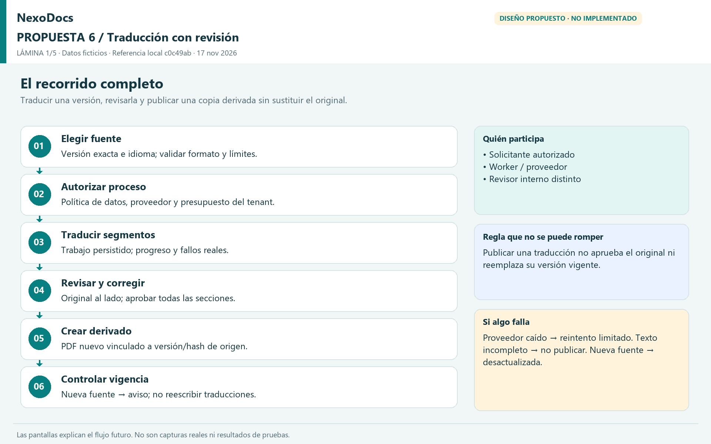
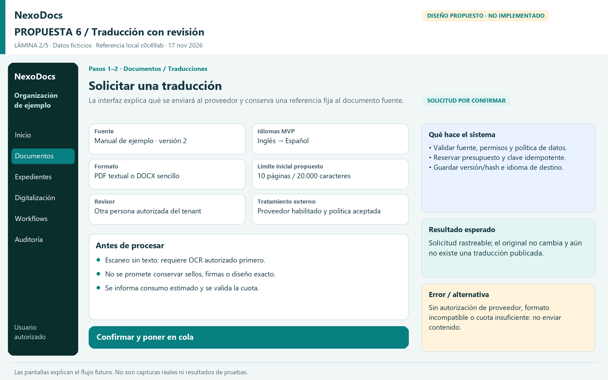
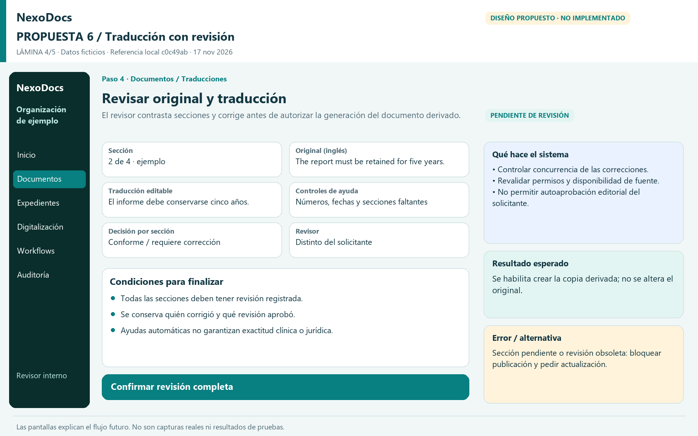
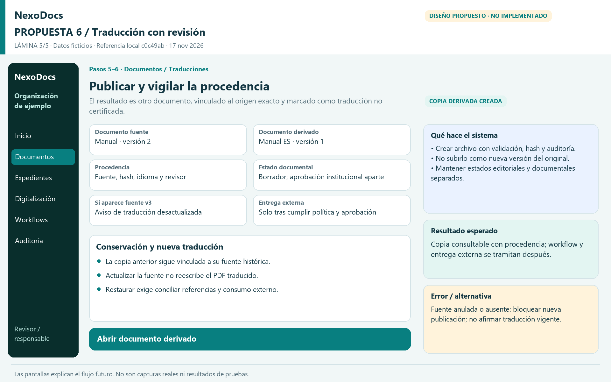

# P06: traducción documental con revisión humana

> Revisión documental: 2026-11-17. Referencia: `c62e9fc` mas cambios locales. Propuesta funcional; no todos los pasos descritos a continuacion estan implementados. El estado del codigo y sus pruebas se detalla en [operaciones documentales](../04-dominio-y-negocio/operaciones-documentales.md).

**Como** usuario autorizado, **quiero** traducir una versión y revisarla antes de publicarla, **para** trabajar en otro idioma conservando el original y la procedencia.

Ejemplo ficticio: un manual en inglés versión 2 requiere copia en español. Cambiar ES/EN en el shell actual traduce la interfaz, no el contenido de archivos. Este módulo crea una copia documental derivada, no sobrescribe el manual ni convierte una traducción automática en certificada.

## Estado del alcance

Implementado: PDF con texto verificable (hasta 10 paginas/20.000 caracteres), consentimiento por solicitud, glosario, Gemini fuera de transaccion, limite diario, bloqueo de solicitud activa duplicada, revision por otra persona con control de concurrencia y publicacion de documento/version separados. El PDF derivado pagina y conserva acentos; no es certificado. Hay pruebas con proveedor simulado y navegacion real; Dos ciclos con Google real y otra cuenta revisora pasaron el 2026-11-18; ver [pruebas y cuenta local](../04-dominio-y-negocio/traduccion-pruebas-locales.md). Esto no valida las ampliaciones propuestas.

Continuan como propuesta: DOCX, politica de datos configurable por tenant, seleccion previa del revisor, presupuesto monetario, segmentacion granular y reanudacion automatica tras reinicio. Actualmente el resultado se revisa como un bloque; una interrupcion prolongada se registra como fallo sin reintento automatico. El flujo de PDF ya puede procesarse si el backend tiene proveedor configurado, pero esto no acredita el alcance completo de esta propuesta.

## Recorrido propuesto paso a paso

### 1. Seleccionar versión e idioma

Documento → **Traducciones** → Nueva solicitud. Elegir versión exacta e idioma destino. MVP: PDF con texto y DOCX sencillos, inglés/español. Propuesta de límite inicial: 10 páginas o 20.000 caracteres por solicitud, ajustable tras pruebas; mantener además el límite de archivo vigente. La pantalla informa incompatibilidades antes de enviar.

PDF cifrado/protegido, contenido complejo y formatos no soportados se rechazan con explicación. Un escaneo sin texto requiere OCR autorizado y verificado antes de traducir; no mandar imágenes ocultamente a un proveedor. No prometer conservación exacta de tablas, sellos, firmas o maquetación.

### 2. Confirmar tratamiento externo y presupuesto

El administrador debe habilitar el proveedor por tenant y definir tipos de datos admitidos. La solicitud muestra qué contenido se enviará, límites de consumo y origen/destino. Si el tipo está restringido o falta autorización, bloquear sin invocar al proveedor. La credencial Gemini existente no autoriza automáticamente este nuevo uso.

El responsable elige revisor interno autorizado. Se reserva presupuesto por tenant, con una clave idempotente para evitar cobros duplicados al confirmar dos veces. Mostrar estimación como estimación; nunca inventar precio exacto o prometer costo cero por tener API key.

### 3. Extraer, segmentar y traducir en segundo plano

Una operación persistida captura hash y versión de origen, extrae texto por páginas/secciones, divide en segmentos y traduce con un adaptador. `GeminiClient.generateText` es un candidato reutilizable, pero hay que implementar instrucciones, validación, límites, glosario y tratamiento de fallos. Los textos documentales son datos, no instrucciones para ejecutar herramientas.

El worker conserva progreso real por segmento, modelo/proveedor usados y errores saneados. Reintenta 429/5xx de forma limitada y no publica resultados incompletos. Un reinicio retoma segmentos confirmados; no crea un segundo documento porque el usuario refrescó la pantalla. Los temporales están bajo alcance del tenant y tienen retención.

### 4. Revisar con el original al lado

Un editor presenta texto original y traducción por secciones. El revisor puede corregir, marcar pendiente o rechazar. Mostrar indicadores de números, fechas, unidades y secciones faltantes; son ayudas, no garantía de exactitud clínica o jurídica. Guardar revisiones con control de concurrencia.

Si el solicitante no tiene permiso de revisión no puede aprobar su propio resultado. Política MVP: revisor distinto del solicitante. Las reglas jerárquicas del motor de workflows no se sustituyen por esta revisión editorial.

### 5. Publicar una copia derivada

Después de revisar todas las secciones, el revisor confirma. El servidor valida completitud, permisos y estado actual del origen. Genera un PDF nuevo con idioma, versión fuente y etiqueta de traducción no certificada. Crea un **documento derivado distinto**, con su primera versión y relación a la versión fuente.

No llamar a upload del documento original: ese método cambiaría su versión vigente y podría reiniciar su estado. El nuevo punto de integración debe repetir las validaciones y auditoría de almacenamiento sin saltarse reglas de workflow. La revisión de traducción no pone APPROVED al documento derivado: si necesita aprobación institucional, inicia el flujo habitual.

### 6. Consultar o entregar

En el original aparece una lista por idioma, origen, fecha, revisor y estado de la traducción. Cada derivado mantiene sus permisos y archivo. Su entrega a externos utiliza P01 únicamente cuando cumpla las condiciones de aprobación de la versión derivada; nunca se comparte automáticamente por terminar la traducción.

### 7. Detectar desactualización

Si aparece una versión fuente posterior, la traducción conserva su referencia histórica y muestra **Desactualizada respecto de la versión vigente**. No se modifica el archivo publicado. Se solicita una nueva traducción o revisión contra la nueva fuente. Si el original se anula o se retira, bloquear nuevas publicaciones/entregas relacionadas hasta resolverlo.

Tras una restauración, conciliar origen y derivado por versión/hash; no anunciar vigente una traducción cuyo origen falta. No reejecutar llamadas pagas automáticamente por rebobinar el estado de un job; conservar ledger de solicitudes/consumo.

## Recorrido visual

## Estados y datos

| Objeto | Valores propuestos |
|---|---|
| Solicitud | QUEUED, EXTRACTING, TRANSLATING, REVIEW_PENDING, CHANGES_REQUESTED, PUBLISHED, FAILED, CANCELLED |
| Relación de vigencia | CURRENT_SOURCE, OUTDATED_SOURCE, SOURCE_UNAVAILABLE |

PUBLISHED significa copia derivada creada tras revisión; el estado DRAFT/APPROVED/CURRENT del documento derivado sigue siendo el del módulo documental. No mezclar las dos máquinas de estado.

Tablas propuestas: `translation_requests`, `translation_segments`, `translation_reviews`, `document_derivations`, política/glosario por tenant y ledger de consumo. Guardar idioma, hash/UUID de fuente, autor/revisor, proveedor/modelo, tiempos y vínculo al derivado. Los segmentos contienen información sensible: RLS, mínimos permisos, cifrado/retención según política; no copiarlos a auditoría o logs.

## Qué implementar

- Angular: solicitud, consentimiento informativo, progreso, revisión lado a lado y lista de derivados/desactualizados. Mostrar estado recibido del backend, sin porcentajes estimados por temporizador.
- Backend: extracción PDF/DOCX, cola, adaptador de traducción, segmentación, glosario, validación estructural, generación de PDF y relación de procedencia.
- Permisos nuevos propuestos: `translation:create`, `translation:read`, `translation:review`, `translation:publish`, `translation:configure`, además de acceso a fuente y permiso documental para crear el derivado según el actor/política.
- Presupuesto y límites: tamaño, páginas/caracteres, cuota del tenant, concurrencia y cancelación. Antes de publicar, revalidar cuota/permiso de creación del derivado para no completar a medias.
- Auditoría: solicitud, autorización de tratamiento, revisión, publicación y cancelación. No registrar texto ni credenciales; consultar progreso rutinario no genera un evento por poll.

**API nueva propuesta:** `POST /api/v1/documents/{id}/translations` (202), `GET /translations/{id}`, `PATCH /translations/{id}/segments/{segmentId}` con control de revisión, `POST /translations/{id}/review`, `/publish` y `/cancel`. Ninguna de estas rutas existe actualmente.

No usar el asistente de ayuda como atajo: hoy sanea/clasifica preguntas y evita enviar texto libre, un contrato distinto. La traducción sí procesaría contenido documental externo, por lo que requiere una política independiente y explícita.

## Criterios de aceptación y pruebas

1. Solicitar sobre una versión exacta, cerrar el navegador y recuperar el progreso sin duplicar llamadas ni documentos.
2. La copia derivada mantiene relación/hash de fuente y no cambia `current_version` ni estado del original.
3. Sin consentimiento/política o sin permisos no se llama al proveedor; el rechazo no consume cuota.
4. Fallos 429, timeout, texto truncado o segmentos faltantes dejan un estado verificable y nunca publican una traducción incompleta.
5. Otro tenant no ve solicitudes, segmentos, glosarios o archivos, incluso con UUID conocido.
6. Publicación exige revisión completa por otra persona; un solicitante no puede aprobarse enviando la petición directamente.
7. Versión nueva deja el derivado anterior identificado como histórico/desactualizado; no lo reescribe.
8. Restauración y reinicio no repiten consumo externo ni vuelven vigente una relación inválida.

Dependencias: biblioteca de extracción/renderizado y proveedor de traducción real con condiciones aceptadas. Ninguna traducción del MVP se presenta como certificada, médica validada o equivalente legal. [Diseño común y referencias](README.md).
